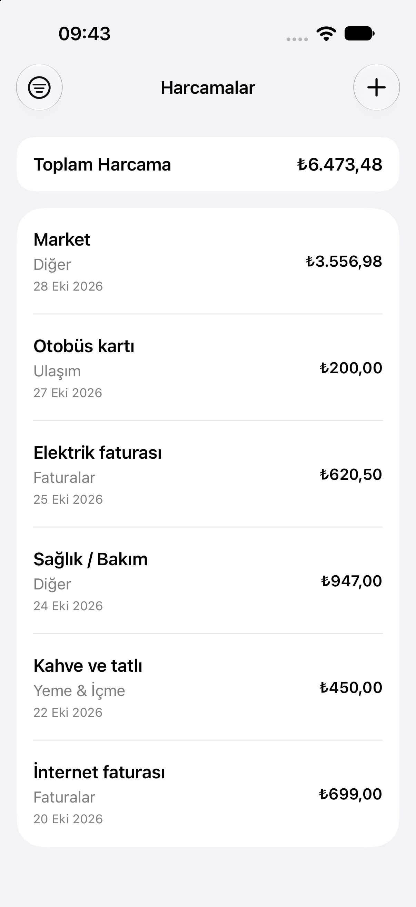
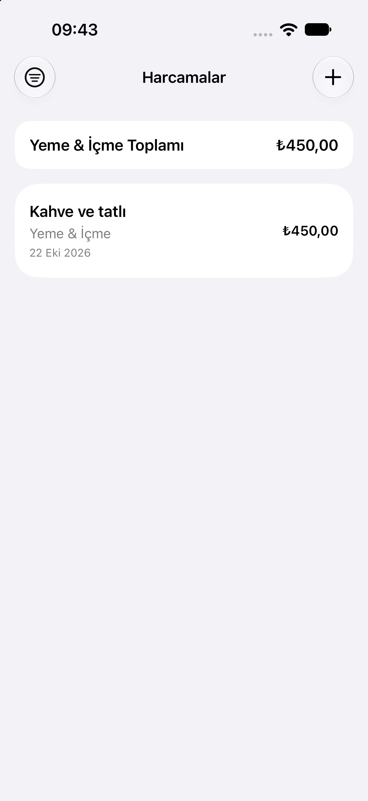
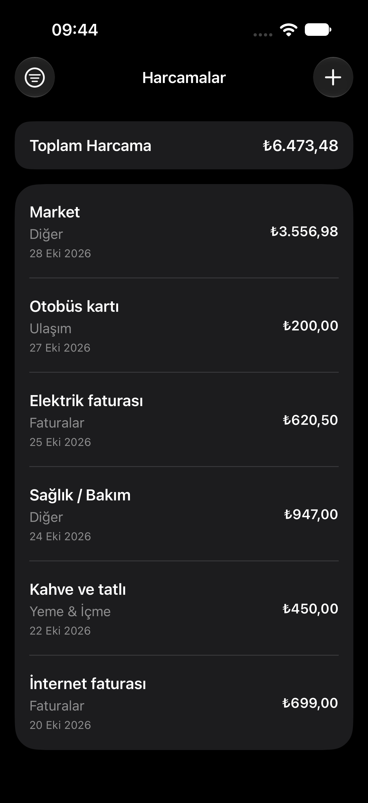

# ExpenseTracker

A simple expense tracker for iOS, built in SwiftUI without tutorials.
Code written by me; AI used as a mentor for reviews and explanations.
This is the Week 1 level assessment of my iOS curriculum.

  
  
  

## Features

- Add expenses with a title, amount, category and date.
- View the total amount, which follows the selected category filter.
- Filter expenses by category.
- Delete expenses with a swipe action.
- Save expenses locally using UserDefaults.
- Notify when a saved expense is hidden by the active filter.
- Reject amounts with more than two decimal places.

## Run

- Xcode version: 27.0
- iOS version: 27.0
- Open `ExpenseTracker.xcodeproj` and run on a simulator.

## What I learned

- A displayed value and a stored value can differ, so I reject extra decimals instead of silently rounding.
- A filter can hide a new item, so I notify the user instead of resetting their choice.
- Error messages can point to the wrong place, so commenting out code and re-enabling it piece by piece helps isolate the source of the problem.

## Known limitations

- Long expense titles are limited to two lines in the list and the full title is not available elsewhere.
- Expenses are stored in UserDefaults, so the saved data is lost when the app is deleted.
